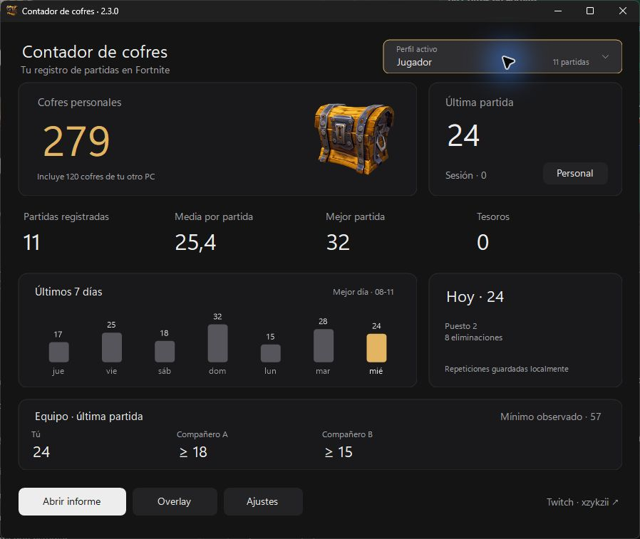
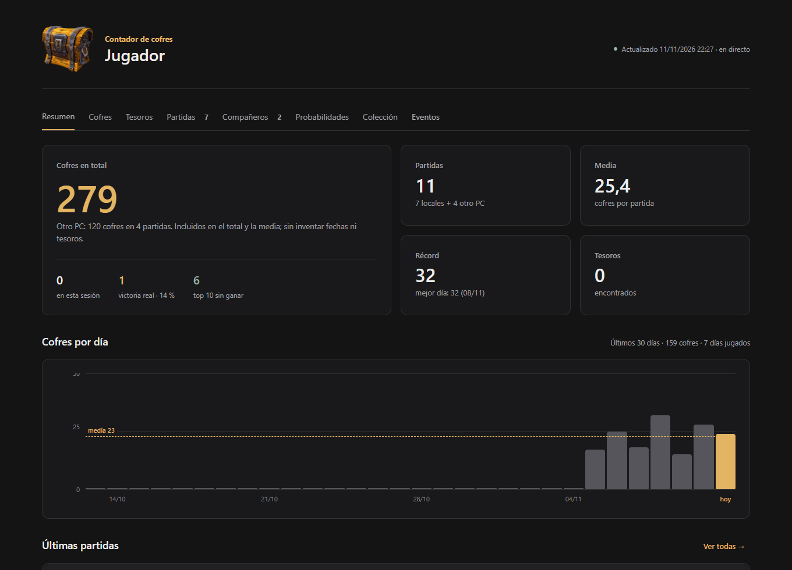

# Fortnite Chest Counter

Contador de cofres para Windows con historial por perfil, informe de partidas, compañeros y overlay. Interfaz propia en grafito y dorado, con el cofre real de Fortnite.

[**Descargar para Windows**](https://github.com/xZykzii/FortniteChestCounter/releases/latest) · [Twitch: xzykzii](https://www.twitch.tv/xzykzii)



## Qué incluye

- Total personal y personal + compañeros observados, con selector visible y atajo **E** en la ventana.
- Selector de perfiles propio: botón oscuro, nombre, partidas y menú accesible con teclado.
- Historial por cuenta, estadísticas diarias, media, récords, eliminaciones y tesoros.
- Informe con pestañas y ranking de compañeros. Los cofres del equipo son un mínimo parcial según lo que contiene tu replay.
- HUD transparente y overlay clásico; el cofre tiene transparencia real. Ctrl+Mayús+O muestra/oculta y Ctrl+Mayús+L bloquea la posición.
- Overlay para OBS en `http://localhost:7373/` mientras el contador está abierto.
- Compatibilidad con los historiales antiguos de ambas bases y registros manuales de otro PC, conservando los conteos personales.
- Colección de premios, probabilidades por cofre, horarios locales de Treasure Hours y catálogo validado con imágenes incluidas para uso sin conexión.
- Avisos de posible subconteo al usar vehículos y detección de cofres destruidos al romper su soporte.
- Filtro opcional de BR normal de la temporada para partidas nuevas; conserva todas las partidas históricas.
- Bandeja del sistema, recuperación de la ventana al abrir otra instancia, confirmación de cierre, ayuda y estimación opcional desde Carrera.
- OBS refleja HUD o clásico según el estilo elegido.
- Actualización del ejecutable manual; el catálogo se puede actualizar desde este repositorio, sin enviar tus partidas.



## Usar

1. Descarga `ChestCounter.exe` desde Releases y ábrelo. Windows 10/11 x64; no necesita instalar .NET.
2. Activa **Grabar repeticiones** en Fortnite. El contador lee los `.replay` guardados en tu PC.
3. Para ver el overlay durante el juego, usa **Pantalla completa en ventana**.
4. En Ajustes puedes configurar inicio, conteo, compañeros, archivos y aspecto del overlay.

No lee la memoria del juego, no inyecta código y no modifica Fortnite. Una actualización del juego puede cambiar el formato del replay.

## Historial y respaldo

Los datos se guardan en `%APPDATA%\ChestCounter`. **No están incluidos en este repositorio ni en las descargas.**

- `data.json`: partidas y recuentos.
- `reported-totals.json`: registro manual por perfil de otro PC.
- `config.json`: preferencias.
- `treasures.json`: nombres de premios.
- `backup-before-combined`: copia anterior a la primera migración.

Haz copia de estos archivos antes de cambiar de versión o de PC. Si importas repeticiones que ya están incluidas en un total manual, concilia ese registro para no sumar ambos. Las mejoras del analizador se aplican a las partidas nuevas; esta edición mantiene el formato 17 y no fuerza el reanálisis del historial. La migración conserva el historial; no inventa fechas, tesoros ni partidas individuales para los registros manuales.

## Compilar

Requiere SDK de .NET 10 en Windows. Desde PowerShell:

```powershell
dotnet publish .\src\ChestCounter\ChestCounter.csproj -c Release -r win-x64 --self-contained true -p:OfflineBuild=true -p:PublishSingleFile=true -p:IncludeNativeLibrariesForSelfExtract=true -p:EnableCompressionInSingleFile=true -p:DebugType=none -o .\dist
```

Comprobaciones con datos sintéticos, sin acceso al historial personal:

```powershell
dotnet run --project .\checks\CombinedChecks.csproj -c Release -p:OfflineBuild=true -- --self-test
```

Para validar una copia de un historial real y, opcionalmente, una repetición de referencia:

```powershell
dotnet run --project .\checks\CombinedChecks.csproj -c Release -p:OfflineBuild=true -- 'C:\ruta\snapshot' 'C:\ruta\prueba-nueva' 'C:\ruta\referencia.replay'
```

Usa una carpeta de prueba nueva. Las comprobaciones verifican preservación de campos, separación de perfiles, migración idempotente, medias, CSV y rechazo de archivos inválidos. Las capturas de esta página utilizan únicamente datos ficticios.

## Procedencia y licencias

Esta edición integra y modifica dos proyectos: [LED-N/Fortnite-ChestCounter v1.5.0](https://github.com/LED-N/Fortnite-ChestCounter/tree/v1.5.0) y [xdoofy92/ChestCounter v2.0.24](https://github.com/xdoofy92/ChestCounter/tree/v2.0.24). El analizador se basa en [FortniteReplayDecompressor de Shiqan](https://github.com/Shiqan/FortniteReplayDecompressor).

El rediseño siguió las pautas de [unslop de Damir Sokolovsky](https://github.com/heydamir/unslop), licenciadas bajo CC BY 4.0. Se aplicaron espaciado consistente, superficies neutras, un único acento, tipografía legible y contenido visual del producto.

Las marcas manuales de colección se guardan por perfil en el navegador, separadas del historial. Las probabilidades son estimaciones del catálogo original, no garantías; las franjas no confirmadas se muestran como previstas.

Código bajo MIT; Barlow Condensed bajo OFL. El cofre de Fortnite y las marcas de Epic Games quedan fuera de la licencia MIT de este código. Proyecto independiente, sin afiliación ni respaldo de Epic Games. Más detalles en [CREDITS.md](CREDITS.md).
